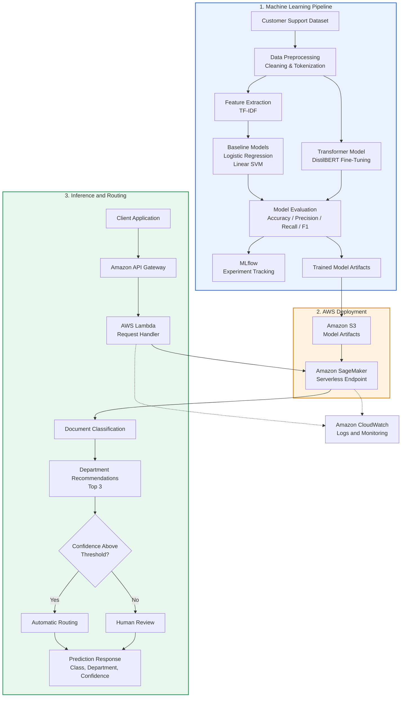

# AI Document Classification & Routing System


## 1. Project Overview

Organizations handle different types of incoming documents every day, including complaints, service requests, incidents, and change requests. Sorting these documents manually can take time and may lead to incorrect assignments.

This project focuses on building an AI-based system that classifies incoming documents based on their text content and recommends the most suitable department for each one.

The system also considers prediction confidence. Documents with uncertain predictions are flagged for human review instead of being automatically processed.

## 2. System Architecture

The project consists of three main parts:

1. **Machine Learning Pipeline:** Data preprocessing, feature extraction, model training, and evaluation.
2. **AWS Deployment:** Storing trained model artifacts and hosting the inference endpoint.
3. **Inference and Routing:** Receiving document text, generating predictions, and recommending the appropriate department.



## 3. Main Features

- **Document Classification:** Classifies incoming documents into predefined categories such as Incident, Request, Problem, and Change.
- **Department Recommendation:** Returns the three most likely departments for each document, along with their confidence scores.
- **Human Review:** Flags predictions with confidence scores below a defined threshold for manual review.
- **Local and Cloud Inference:** Supports local testing and an AWS-based deployment setup.

## 4. Technology Stack

| Component | Technologies |
|---|---|
| Data Processing | Pandas, NLTK, spaCy |
| Baseline Models | Scikit-learn, TF-IDF, Logistic Regression, Linear SVM |
| Transformer Model | Hugging Face Transformers, DistilBERT |
| Experiment Tracking | MLflow |
| Backend and Local API | Python, FastAPI |
| Cloud Storage | Amazon S3 |
| Model Hosting | Amazon SageMaker Serverless Endpoints |
| API and Request Handling | AWS Lambda, API Gateway |
| Monitoring | Amazon CloudWatch |

## 5. Repository Structure

```text
NHA-5-168/
│
├── README.md
├── requirements.txt
├── .gitignore
├── config.yaml
│
├── data/
│   ├── raw/
│   └── processed/
│
├── notebooks/
│   ├── 01_eda.ipynb
│   ├── 02_baseline.ipynb
│   └── 03_transformer.ipynb
│
├── src/
│   ├── preprocess.py
│   ├── train_baseline.py
│   ├── train_transformer.py
│   ├── evaluate.py
│   └── predict.py
│
├── aws/
│   ├── lambda_handler.py
│   └── deploy_endpoint.py
│
└── docs/
    └── architecture.md
```

**Note:** The `data/` directory is not included in the repository. The dataset should be downloaded separately before running the preprocessing scripts.

## 6. Dataset

The project uses the **Customer Support Tickets** dataset by Tobias Bück.

The dataset is available through Kaggle and Hugging Face.

The original dataset files are not included in this repository. Users need to download the dataset and place the files inside `data/raw/` before running the project.

Dataset licensing and usage conditions should be checked before redistribution or commercial use.

## 7. Model Performance Comparison

The project evaluates different approaches to document classification, starting with traditional machine learning models and then comparing them with a Transformer-based model.

All models are evaluated using the same train/test split to make the comparison consistent.

| Model | Accuracy | Precision | Recall | F1-Score |
|---|---|---|---|---|
| Logistic Regression | TBD | TBD | TBD | TBD |
| Linear SVM | TBD | TBD | TBD | TBD |
| DistilBERT | TBD | TBD | TBD | TBD |

*The metrics will be added after completing the final training and evaluation runs.*

## 8. Running the Project Locally

The project can be tested locally without deploying the model to AWS. This setup uses a locally trained model and a FastAPI application to handle prediction requests.

### 8.1. Clone the Repository

```bash
git clone https://github.com/nhahub/NHA-5-168.git
cd NHA-5-168
```

### 8.2. Install Dependencies

```bash
pip install -r requirements.txt
```

### 8.3. Prepare the Dataset

Download the dataset and place the required files inside:

```text
data/raw/
```

### 8.4. Run Preprocessing and Training

```bash
python src/preprocess.py
python src/train_baseline.py
```

### 8.5. Start the Local API

```bash
uvicorn src.predict:app --reload
```

Once the server starts, the API will be available at:

```text
http://localhost:8000
```

The prediction endpoint can be tested using POST requests:

```text
http://localhost:8000/predict
```

## 9. AWS Deployment

For the cloud deployment setup, the locally hosted inference service is replaced by AWS services.

The deployment workflow consists of the following steps:

1. Upload the trained model artifacts to an Amazon S3 bucket.
2. Create a SageMaker Serverless Endpoint to host the model.
3. Configure an AWS Lambda function to handle incoming prediction requests.
4. Expose the Lambda function through Amazon API Gateway.
5. Use Amazon CloudWatch to monitor logs and execution activity.

This setup separates model training from inference and allows the model to be accessed through an API.

## 10. System Screenshots

Screenshots and demo results will be added here once the application interface and testing workflow are ready.

### 10.1. Classification Results

This section will show an example of a document classification result, including the predicted document type and the top three department recommendations.

### 10.2. Human Review

This section will demonstrate how the system handles predictions with confidence scores below the selected threshold.

## 11. Team Members

This project was developed as part of the **Digital Egypt Pioneers Initiative (DEPI)**.

- **Ahmed Mahmoud Mostafa Abdelkarim**
- **Abdelrahman Mohamed Ezz**
