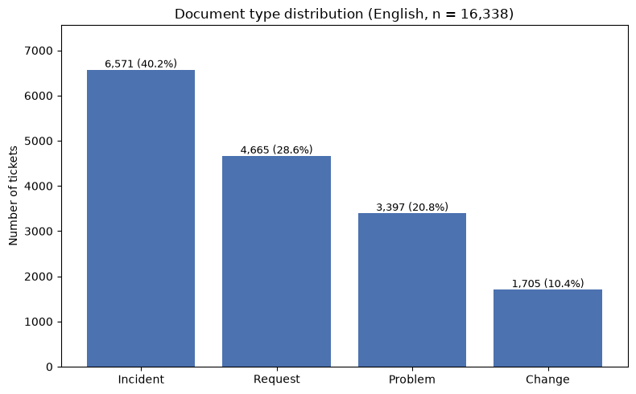
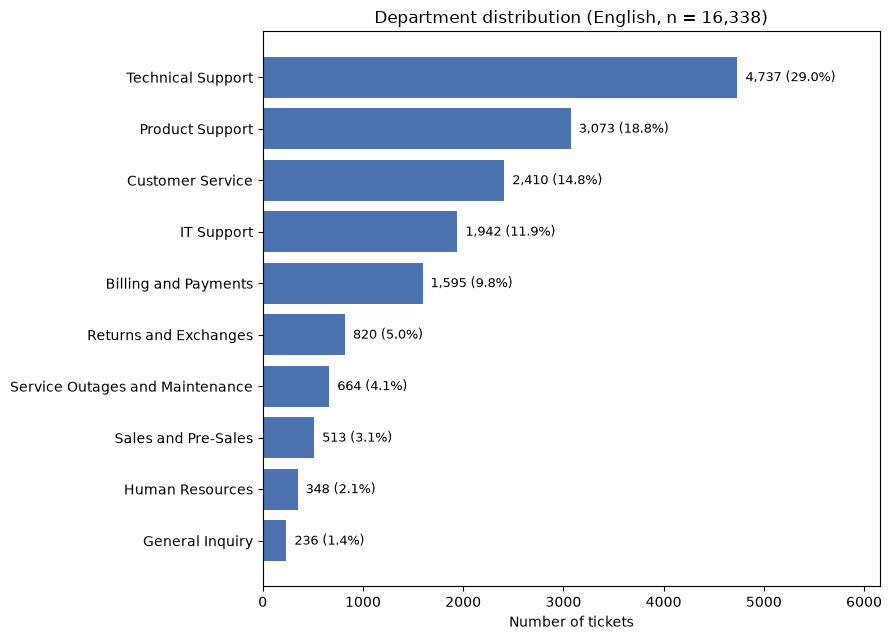
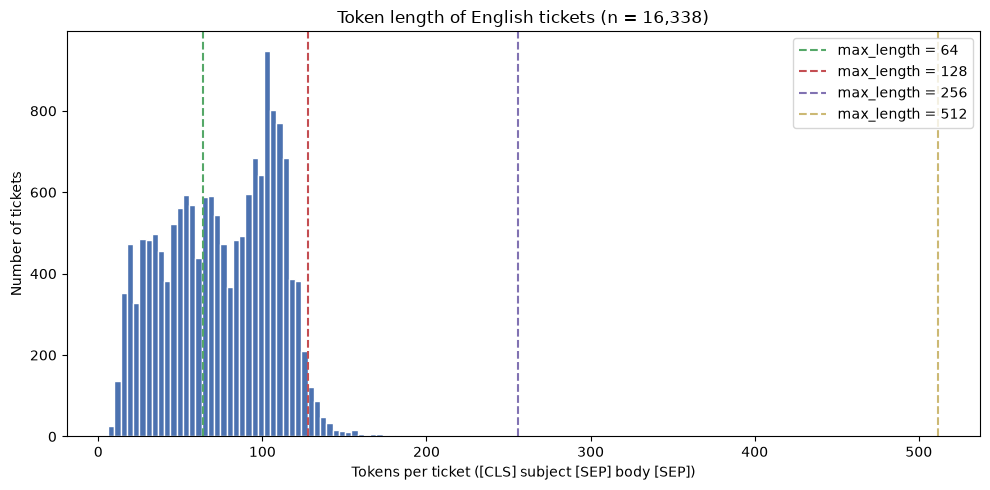
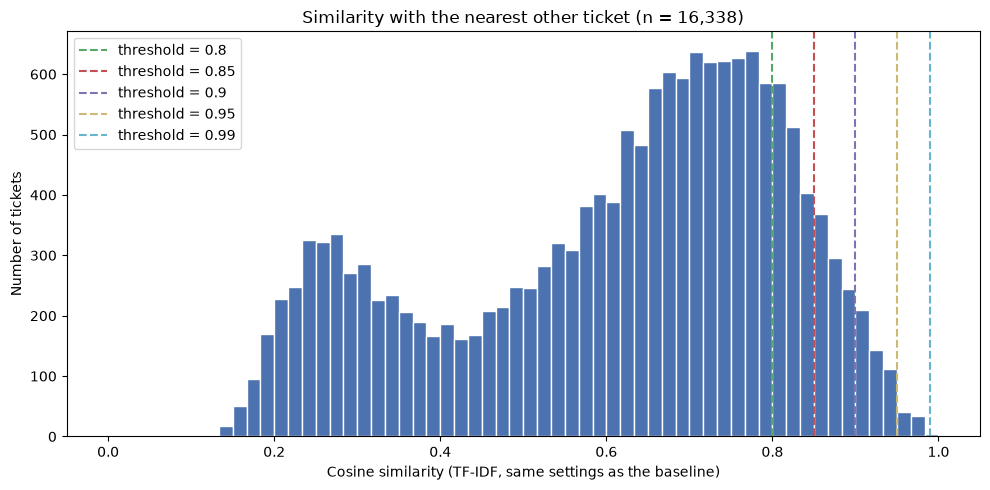
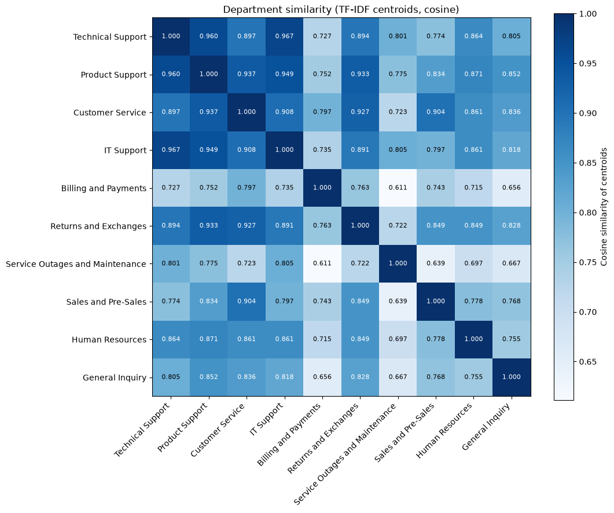

# Exploratory Data Analysis Report

| | |
|---|---|
| **Project** | AI Document Classification & Routing System (DEPI, AWS track) |
| **Team** | Abdelrahman Mohamed Ezz, Ahmed Mahmoud Mostafa Abdelkarim |
| **Notebook** | `notebooks/01_eda.ipynb` (sections 1–11) |
| **Data** | Tobi-Bueck/customer-support-tickets (Hugging Face, CC BY-NC 4.0, synthetic), file `aa_dataset-tickets-multi-lang-5-2-50-version.csv` |
| **Date** | 28 November 2026 |

---

## 1. Summary

- We use **16,338 English tickets** (from 28,587 rows). The two targets are the **document type** (4 classes) and the **department** (`queue`, 10 classes).
- The data is **clean**. There are no exact duplicates and no misspelled labels, and every label matches `config.yaml`.
- The departments are **strongly imbalanced**. The largest is 20.1 times bigger than the smallest (Technical Support 29.0%, General Inquiry 1.4%). The main metric is therefore **macro F1**.
- The texts are **short**. The longest ticket has 234 DistilBERT tokens, so `max_length = 256` truncates no ticket.
- **Main finding:** the data is made of **paraphrase families**, which are the same ticket written two or three times with different wording. Pairs of similar tickets share the same department in **98.4%** of cases, against 17.1% by chance. A random split would therefore put sister tickets in train and test and **inflate every score**. **Decision DEC-13:** use a **group split** by family (Union-Find, similarity threshold 0.5).
- **Department labels are only weakly tied to the text.** Billing and Service Outages have clear vocabulary. Technical, Product, IT, Customer Service and Returns share almost the same vocabulary. This places a ceiling on department macro F1 and makes the **top-3** suggestions and the **needs_review** flag central to the product.
- **Reference baselines** (the floor any model must beat): department macro F1 > 0.10, accuracy > 0.29, top-3 accuracy > 0.626; type macro F1 > 0.25, accuracy > 0.40.

---

## 2. Data and scope

| Item | Value |
|---|---|
| Rows × columns | 28,587 × 16 |
| Columns | subject, body, answer, type, queue, priority, language, version, tag_1 … tag_8 |
| Languages | English 16,338 · German 12,249 |
| Used | English only (the model is English only) |
| Model input | subject + body (two segments for DistilBERT, joined text for TF-IDF) |
| Not used | `answer` (the agent's reply, leakage), `tag_1 … tag_8` (leakage, see section 6) |

---

## 3. What we did (method)

Each analysis is a function with parameters so that it can be reused, followed by a separate run cell.

| Section | Question | Main functions |
|---|---|---|
| 1 Load | Is the file read correctly? Duplicates? | column profile, 4-level duplicate check |
| 2 English | How many English tickets? | filter on `language` |
| 3 Missing | What is missing, and is it random? | missing table, missing rate by queue/type/priority |
| 4 Type | Distribution and quality of `type` | `check_label_consistency`, `compare_with_config`, `count_labels`, `imbalance_ratio`, `plot_label_distribution` |
| 5 Department | The same for `queue`, plus small test sizes | the same functions, plus `small_classes_in_test` and `group_share` |
| 6 Relationships | Which columns are linked? | Cramér's V (chi-square written by hand), type-by-department table |
| 7 Text length | Characters, words, DistilBERT tokens, `max_length` | `text_lengths`, `length_statistics`, `find_short_texts`, `build_joined_texts`, `compute_token_lengths`, `truncation_share`, `token_length_by_group` |
| 8 Near-duplicates | Are there tickets that are almost the same? | `normalize_text`, `find_normalized_duplicates`, `find_nearest_neighbors` (TF-IDF cosine), `label_agreement`, Union-Find (`find_root`, `union_groups`, `build_families`) |
| 9 Overlapping departments | Can the departments be told apart from the text? | `sample_tickets_per_group`, `distinctive_words`, `group_centroid_similarity`, `plot_similarity_heatmap` |
| 10 Reference baselines | What does a model that does not read the text score? | `accuracy`, `per_class_scores`, `macro_f1` (written by hand and checked against sklearn), majority, top-3, stratified random |

---

## 4. Results

### 4.1 Loading, language and missing values (sections 1–3)

- The file was read correctly. There are **0 duplicates** at four levels: whole row, subject + body, body only, and the same text with different labels.
- English: **16,338** tickets.
- Missing values in the English data:

| Column | Missing | % |
|---|---|---|
| subject | 2,607 | 16.0 |
| answer | 3 | 0.02 |
| tag_4 … tag_8 | 1,711 … 16,057 | 10.5 … 98.3 |

- A missing subject is **random with respect to the labels** (between 12.5% and 20.8% per department, Cramér's V with the department 0.04). It is **not** random with respect to length: tickets without a subject have **longer bodies** in every generator version (version 400: 63 vs 47 words). It is therefore not strictly MCAR.

### 4.2 Labels (sections 4–5)

**Document type:** the labels are clean and match the config. Imbalance ratio **3.9** (moderate).

| Type | Tickets | % |
|---|---|---|
| Incident | 6,571 | 40.2 |
| Request | 4,665 | 28.6 |
| Problem | 3,397 | 20.8 |
| Change | 1,705 | 10.4 |

**Department:** the labels are clean and match the config. Imbalance ratio **20.1** (strong).

| Department | Tickets | % |
|---|---|---|
| Technical Support | 4,737 | 29.0 |
| Product Support | 3,073 | 18.8 |
| Customer Service | 2,410 | 14.8 |
| IT Support | 1,942 | 11.9 |
| Billing and Payments | 1,595 | 9.8 |
| Returns and Exchanges | 820 | 5.0 |
| Service Outages and Maintenance | 664 | 4.1 |
| Sales and Pre-Sales | 513 | 3.1 |
| Human Resources | 348 | 2.1 |
| General Inquiry | 236 | 1.4 |

- With a 10% test set, Human Resources would have about **35** test tickets and General Inquiry about **24**, both below 50, which makes their F1 unreliable. This is why we moved to a **70/15/15** split (DEC-10).
- The four overlapping departments (Technical, Product, Customer Service, IT) make up **74.4%** of the data.

### 4.3 Relationships between columns (section 6)

Cramér's V, where 0 means no link and 1 means full link:

|  | type | queue | priority | subject_missing | tag_1 |
|---|---|---|---|---|---|
| type | 1.00 | 0.19 | 0.06 | 0.02 | **0.44** |
| queue | 0.19 | 1.00 | 0.28 | 0.04 | **0.34** |

- Type and department are only weakly linked (0.19), which supports two separate models (DEC-1).
- `tag_1` is strongly linked to both targets, so the tags would **leak** the answer and are not used.
- Some departments have a typical type: Service Outages 55.6% Incident, Human Resources 52.9% Incident, Sales 50.3% Request, Billing 48.3% Request.

### 4.4 Text length (section 7)

| Measure | Mean | Median | p95 | Max |
|---|---|---|---|---|
| Body, characters | 367.9 | 377 | 604 | 1,147 |
| Body, words | 53.9 | 55 | 90 | 168 |
| Subject, words (missing = 0) | 4.8 | 5 | 9 | 29 |
| Tokens, `[CLS] subject [SEP] body [SEP]` | 74.3 | 76 | 121 | 234 |

- There are about 1.21 DistilBERT tokens per word (WordPiece plus punctuation).
- No joined text is shorter than 10 characters. The shortest is 18 characters.
- Share of tickets truncated at each `max_length`: 64 → 59.7%, 128 → 2.2%, **256 → 0%**, 512 → 0%. At 256, no department loses any token.
- The histogram has two humps and a sharp wall at about 120–130 tokens. This is a length cap of the generator, and real documents will not have it.
- The `version` column (generator version) changes the length (median body words: v51 78, v52 67, v400 49) but not the department shares, so it does not leak the label.
- 740 bodies contain the literal text `\n` (a backslash and the letter n), not real line breaks.

### 4.5 Near-duplicates and paraphrase families (section 8)

- **Exact duplicates after normalization** (lowercase, no punctuation, single spaces): **1 extra copy** (rows 3365 and 3832, which differ only by a final full stop and have the same labels).
- **Nearest neighbour** (TF-IDF with the baseline settings, cosine similarity): mean 0.609, median 0.658, p95 0.881.

| Similarity with the nearest other ticket ≥ | 0.80 | 0.85 | 0.90 | 0.95 |
|---|---|---|---|---|
| Tickets | 18.1% | 8.9% | 3.3% | 0.5% |

- **Reading the pairs:** down to a similarity of about **0.5**, pairs are the **same ticket reworded** (same problem, same details, other words). There is no clean threshold that separates paraphrases from different tickets. The dataset card does not describe how the data was generated.
- **Label agreement in neighbour pairs:**

| Similarity ≥ | 0.3 | 0.4 | 0.5 | 0.6 | 0.7 | ≥ 0.9 | Chance |
|---|---|---|---|---|---|---|---|
| Same department | 87.9% | 95.2% | **98.4%** | 99.2% | 99.8% | 100% | 17.1% |
| Same type | 96.7% | 99.1% | 99.7% | 99.9% | 100% | 100% | 29.7% |

- Label noise is low (about 1.6% at 0.5). The four overlapping departments appear in the conflicts about as often as their size predicts, so there is no special label confusion. Type conflicts are mostly **Incident ↔ Problem**, which are close in meaning.
- **Families** (Union-Find over nearest-neighbour links):

| Threshold | Families | Size 1 | Size 2 | Size 3 | Size ≥ 4 | Largest | Tickets with relatives |
|---|---|---|---|---|---|---|---|
| 0.3 | 7,141 | 2,066 | 2,525 | 1,573 | 977 | 26 | 87.4% |
| 0.4 | 8,297 | 3,375 | 2,733 | 1,497 | 692 | 16 | 79.3% |
| **0.5** | **9,182** | 4,561 | 2,738 | 1,335 | 548 | **11** | **72.1%** |
| 0.6 | 10,466 | 6,503 | 2,506 | 1,068 | 389 | 8 | 60.2% |
| 0.7 | 12,459 | 9,657 | 1,959 | 638 | 205 | 5 | 40.9% |
| 0.8 | 14,682 | 13,386 | 994 | 247 | 55 | 5 | 18.1% |

- The families stay small, so a group split is possible. The data holds about **9,200 different cases**, not 16,338.
- Families per department at 0.5: Technical 2,686 · Product 1,765 · Customer Service 1,377 · IT 1,125 · Billing 867 · Returns 462 · Service Outages 382 · Sales 288 · Human Resources 194 · **General Inquiry 132** (about 20 families in the test set, so its test F1 will be noisy).
- Limitation: each ticket is linked to its single nearest neighbour only, so the families are slightly under-estimated.

### 4.6 Overlapping departments (section 9)

- **Reading 30 tickets** (3 per department, seed 42): the content often does **not** match the department name. Human Resources had 0 of 3 tickets about employees, and Returns had 0 of 3 about product returns (one was "Investment *Returns* Forecasting", a keyword trap). The same topics (hospital data security, investment analytics, marketing campaigns) appear in many departments. A human reader could not guess the department.
- **Distinctive words** (share of the department's tickets that contain the word, and ratio against the other departments):

| Level | Departments | Evidence |
|---|---|---|
| Easy | Billing and Payments, Service Outages | `billing` in 56.1% of Billing tickets (0.0% elsewhere); `service` 46.1%, `outage` 22.6% |
| Partly | Human Resources, Returns, Sales, General Inquiry | `employee` 12.6%; `returns` 8.8%; `pricing` 7.4%; General Inquiry = marketing words (`engagement` 21.2%) |
| Hard | Technical, Product, Customer Service, IT | the best word covers < 3% of the department's tickets |

- **Centroid similarity** (cosine between the average TF-IDF vectors): the closest pairs are Technical–IT 0.967, Technical–Product 0.960, Product–IT 0.949, Product–Customer Service 0.937 and Product–Returns 0.933. Billing (0.61–0.80) and Service Outages (0.61–0.81) are the farthest from all the others. Caveat: the centroids of large departments drift toward the overall average.

- **Conclusion:** the hard group has **five** members (Technical, IT, Product, Customer Service, Returns), not four. Labels are only weakly tied to the text, so department macro F1 has a ceiling. There is also a risk of **shortcut learning**, for example marketing words → General Inquiry, or the word "returns" → Returns.

### 4.7 Reference baselines (section 10)

These were computed on all English tickets and will be recomputed on the test set after the split. Our hand-written metrics match sklearn (difference 0).

| Target | Baseline | Accuracy | Macro F1 | Top-3 accuracy |
|---|---|---|---|---|
| Department | Majority class | 0.290 | 0.045 | – |
| Department | Most-frequent top-3 | – | – | **0.626** |
| Department | Stratified random (100 runs / formula) | 0.170 / 0.171 | 0.100 / 0.100 | – |
| Type | Majority class | 0.402 | 0.143 | – |
| Type | Stratified random (100 runs / formula) | 0.297 / 0.297 | 0.250 / 0.250 | – |

- The majority class beats random on accuracy but loses on macro F1, because it ignores 9 of the 10 departments. This is why macro F1 is the main metric.
- A top-3 that always suggests the three largest departments already reaches 62.6%, so the model's top-3 must be compared against that number.

---

## 5. Decisions

| ID | Date | Decision | Based on |
|---|---|---|---|
| DEC-1 | — | Two separate models (type and department), and two baselines | Cramér's V type–department 0.19 |
| DEC-7 | 23 Nov | Missing subject → `""`. Compare plain concatenation (E1) with two segments + subject dropout p ∈ {0, 0.15, 0.3} (E4). The slice analysis includes body length × subject present/missing | 16% missing subject; very short bodies rely on the subject |
| DEC-8 | 23 Nov | Type: baseline without weights vs `class_weight="balanced"`; compare macro F1 and calibration; no oversampling | Imbalance 3.9 |
| DEC-9 | 24 Nov | Department: the same experiment. Oversample small departments (train only) only if General Inquiry and HR come out very weak | Imbalance 20.1 |
| DEC-10 | 24 Nov | Split **70 / 15 / 15**, keeping department proportions | Small departments too small in a 10% test |
| DEC-11 | 26 Nov | `min_text_chars` stays 10 as a guard (removes 0 tickets). `preprocess.py` logs how many tickets it removes. The API validates empty input | Shortest text 18 chars; length does not separate useful from empty texts |
| DEC-12 | 26 Nov | `max_length` stays **256** (0% truncated, margin for real documents). `transformer.max_length = inference.max_length`. The API logs token length and truncation (not the text) | Max 234 tokens |
| DEC-13a | 26 Nov | De-duplication compares texts after `normalize_text`. The model still receives the original text | 1 duplicate hidden by punctuation |
| **DEC-13** | 27 Nov | **Group split** by paraphrase family: Union-Find over nearest-neighbour links (TF-IDF cosine, baseline settings) at **threshold 0.5**. Each family goes entirely to train, validation or test (70/15/15, department proportions as close as possible). Afterwards, check the shares and verify that no sibling ≥ 0.5 crosses the splits | Paraphrases down to 0.5; 98.4% label agreement; a missed sibling (leakage) costs far more than an extra link |
| — | 28 Nov | Top-3 and needs_review are central parts of the output. Department macro F1 is judged against the reference baselines, not against 1.0 | Section 9 |

---

## 6. Predictions to check with the baseline

Written **before** training, so that we can test our understanding of the data:

| Group | Departments | Expected F1 |
|---|---|---|
| Easy | Billing and Payments, Service Outages | High |
| Partly | Human Resources, Returns, Sales | Low to medium (only the tickets with keywords) |
| Topic | General Inquiry | Unpredictable; low precision (marketing tickets from other departments) |
| Hard | Technical, Product, Customer Service, IT (+ Returns) | Low; confused with each other in the confusion matrix |
| — | Type (4 classes) | Easier than department; main confusion Incident ↔ Problem |

---

## 7. Changes needed

| Where | Change |
|---|---|
| `config.yaml` | Split 70/15/15 and group split (family threshold 0.5); `baseline.class_weight` for DEC-8/9; clarify the `min_text_chars` comment |
| SRS, FR-3 | "80/10/10 stratified" → "70/15/15 group split by paraphrase family" |
| SRS | Add DEC-7 to DEC-13 |
| `preprocess.py` | Normalized de-duplication; families + group split; log the rows removed by `min_text_chars` |
| Baseline phase | Learning curve (25/50/75/100% of train); confusion matrix (decides OP-1); recompute the reference baselines on the test set |

---

## 8. Open points

| ID | Point | When |
|---|---|---|
| OP-1 | Merge overlapping departments? The candidates are now the group of five | After the baseline confusion matrix |
| — | Replace the literal `\n` text in 740 bodies? | When `preprocess.py` is written |
| — | Link the k nearest neighbours instead of one, if the cross-split leakage check fails | After the split |
| — | German tickets are probably translations of the same families; never add them without family grouping | Future work |
| — | Check that type and `version` are well spread across the splits | After the split |

---

## 9. Next step

1. Agree on this report with the team.
2. Write `preprocess.py`: cleaning, normalized de-duplication, families, group split, saved splits with checksums (FR-4).
3. Baseline: TF-IDF + Logistic Regression / Linear SVM, logged in MLflow; compare against section 4.7 and the predictions in section 6.
